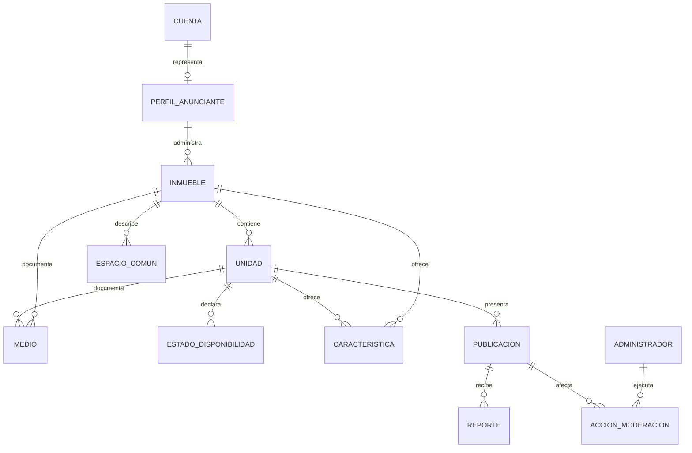

# Investigación arquitectónica comparativa para el MVP

**Fecha de consulta:** 2026-10-16
**Estado:** investigación y recomendación provisional. Ningún stack, arquitectura o proveedor está aprobado.
**Alcance:** análisis documental para el MVP aprobado en F00-H04. No incluye ejecución, compra, configuración ni pruebas contra cuentas o datos reales.
**Criterio estratégico incorporado, 2026-10-16:** priorizar software open source y alternativas de costo cero cuando satisfagan los requisitos funcionales, legales y técnicos. Este criterio orienta la comparación, pero no ratifica stack, proveedor, servicio externo ni gasto.

**Actualización focalizada:** la comparación económica posterior para la solicitud F00-H04 se encuentra en [viabilidad real a costo cero](viabilidad-costo-cero.md). Para esa evaluación, “A” significa plataforma gestionada integrada y “B” servicios gratuitos desacoplados; estos rótulos no son equivalentes a las opciones A/B históricas de las secciones 16 a 19. La evaluación focalizada reemplaza la recomendación y los supuestos económicos anteriores cuando se evalúa auth, correo, backups/restauración, imágenes, frenos de cargos y escenarios optimizados. Las secciones anteriores se conservan como antecedente, no como el dictamen económico vigente.

Dirección aprobó después la política económica “USD 0 por defecto, con gastos únicamente mediante autorización humana expresa”, documentada en [decisiones del proyecto](../../../direccion/decisiones.md). Esta aprobación resuelve la política económica; no aprueba cuentas, proveedores, servicios, arquitectura o gastos.

## 1. Resumen ejecutivo

El alcance A aprobado se ajusta conceptualmente a una aplicación web responsive con una experiencia pública de búsqueda, un área autenticada de anunciantes y herramientas administrativas básicas. El dominio contiene relaciones entre inmuebles, unidades, medios, disponibilidad y moderación, además de búsquedas por ubicación. Esto favorece evaluar una persistencia relacional con capacidad geoespacial, pero no determina un producto o proveedor.

Para orientar la siguiente decisión se comparan tres patrones: plataforma gestionada integrada; aplicación propia con servicios de infraestructura gestionados por separado; y operación autogestionada. A partir del criterio estratégico actualizado, se comparan además tres opciones completas open source/free-tier/autogestionada en las secciones 16 a 19. La referencia provisional para profundización es la opción modular con PostgreSQL/PostGIS, contrastada con la opción de menor costo monetario; no es una selección.

La evaluación actual no permite confirmar precisión de mapas o geocodificación en Tunja, decidir si la ubicación pública debe ser exacta, ni cerrar presupuesto o metas de disponibilidad. Son entradas para una decisión humana y pruebas específicas antes de arquitectura definitiva.

La revisión adicional encuentra alternativas técnicamente plausibles de costo mensual cero en escenarios pequeños, pero no permite declarar una arquitectura de producción segura, sostenible y sin costos inevitables. Las cuotas gratuitas son condicionales; algunos servicios pueden pausar o carecen de SLA; el SMTP gratuito de Supabase es solo para pruebas y sus proyectos gratuitos no tienen copias descargables. En este informe, “cabe en cuota gratuita” no equivale a garantía de operación.

## 2. Base de producto y límites

La matriz que rige esta comparación es [propuesta-alcance-mvp.md](propuesta-alcance-mvp.md), actualizada con la ratificación humana del 2026-10-16. Categoría A incluye exploración pública, publicaciones, administración de anunciantes, contacto inicial por WhatsApp y moderación básica. Categoría B incluye panoramas 360° existentes sujetos a evaluación, favoritos y administración avanzada. Categoría C excluye del MVP reservas, pagos integrados, contratos, reseñas, chat interno, IA y expansión fuera de Tunja.

Los pagos entre arrendatario y propietario y los cobros comerciales de Ubícate a anunciantes quedan fuera del MVP aprobado. La búsqueda es gratuita para quien busca como orientación provisional, no como tarifa o modelo comercial definitivo. No se derivan requisitos de arquitectura para cobros en esta comparación.

No hay previsión de tráfico, anuncios, presupuesto, tasa de conversión ni objetivos de disponibilidad aprobados. Los escenarios de costos de la sección 9 son ejemplos aritméticos, no pronósticos.

## 3. Patrones arquitectónicos

| Patrón | Descripción | Ventajas potenciales | Costos y riesgos | Encaje provisional |
| --- | --- | --- | --- | --- |
| P1. Aplicación modular en plataforma gestionada | Aplicación web con capas de dominio explícitas y servicios gestionados para persistencia, identidad, archivos y funciones de servidor | Menos operación de sistemas; inicio más rápido; componentes de datos y autenticación integrados | Dependencia del proveedor; límites de cuotas y planes; controles de acceso deben diseñarse y probarse; costos por servicio y egreso | Compite con P2 bajo el criterio Open Source First y los requisitos de operación actualizados |
| P2. Aplicación propia + servicios administrados desacoplados | API propia y frontend por separado, con base relacional, identidad y almacenamiento contratados como componentes separados | Mayor control de límites, lógica y migración por partes; flexibilidad de proveedores | Más integración, despliegues, observabilidad y tareas de seguridad; mayor costo de mantenimiento | Alternativa si las necesidades de control o portabilidad justifican la operación adicional |
| P3. Infraestructura autogestionada | Servicios de aplicación, base de datos y potencialmente archivos desplegados y operados por el equipo | Control sobre configuración y ciclo de vida; posible previsibilidad de recursos reservados | El equipo asume parches, copias, restauración, monitoreo, disponibilidad, gestión de secretos y respuesta a incidentes | No se prioriza inicialmente sin evidencia de capacidad operativa, aunque debe permanecer como alternativa de costo/control |

**Recomendación provisional inicial:** comparar las plataformas gestionadas con las alternativas modulares y autogestionadas bajo requisitos y cargas iguales. El criterio Open Source First posterior se evalúa en las secciones 16 a 19 y actualiza la prioridad comparativa. No es una recomendación de compra ni una decisión de arquitectura.

### Criterios sugeridos para la decisión posterior

1. Ajuste funcional al modelo inmueble/unidad y consulta geográfica.
2. Seguridad de permisos por anunciante, administración y contenido público.
3. Privacidad y control sobre ubicación y datos de contacto.
4. Carga operativa y capacidad real del equipo.
5. Costos bajo escenarios explícitos, con límites y alertas.
6. Accesibilidad, experiencia móvil, indexación pública y rendimiento.
7. Copias, recuperación, exportación y salida del proveedor.
8. Calidad de documentación, soporte y regiones disponibles.

La ponderación de los criterios y los umbrales de aceptación requieren aprobación de dirección.

## 4. Frontend y renderizado

React recomienda para aplicaciones nuevas comenzar con un framework; su documentación reconoce crear una aplicación desde cero cuando exista una restricción que no encaje con los frameworks recomendados. Next.js ofrece componentes de servidor, renderizado estático/dinámico y exportación estática. El patrón de renderizado afecta indexación de publicaciones, complejidad de hosting y la cantidad de lógica interactiva que requiere JavaScript en el cliente. ([React: Creating a React App](https://react.dev/learn/creating-a-react-app), [Next.js: Glossary](https://nextjs.org/docs/app/glossary))

| Alternativa de experiencia web | Beneficios | Riesgos o preguntas para Ubícate |
| --- | --- | --- |
| React con framework compatible con renderizado híbrido | Permite combinar páginas públicas prerenderizadas con interacción de mapa y área autenticada; la documentación de React lo recomienda como punto de partida general para nuevas apps React | Añade reglas y capacidades del framework; validar compatibilidad con mapas, autenticación, despliegue y equipo |
| SPA con React y API independiente | Modelo de cliente sencillo para la interacción del mapa y formularios; despliegue estático desacoplado | Indexación/primer render de anuncios, estados de carga y gestión de navegación dependen más del cliente; requiere diseñar API desde el inicio |
| Renderizado mayormente estático con rutas dinámicas puntuales | Puede reducir trabajo del servidor para contenido estable y combinarse con islas de interacción | La frecuencia de actualización de disponibilidad/publicaciones determina estrategia de invalidación; no se evaluó a fondo la madurez del stack para el equipo |

**Recomendación provisional:** evaluar renderizado híbrido para fichas públicas indexables junto con interacción cliente del mapa; contrastarlo con SPA si las fichas no requieren indexación en el MVP. Aprobación pendiente. Criterios por definir: contenido público indexable, frecuencia de actualización, URLs compartibles, accesibilidad y capacidades del equipo.

## 5. Persistencia y modelo conceptual

La comparación funcional favorece estudiar una base relacional: una publicación puede relacionar un inmueble con varias unidades, y una unidad con fotografías, condiciones y disponibilidad propias. Para consulta espacial, PostGIS proporciona tipos y consultas geográficas indexables; Supabase documenta su compatibilidad, lo cual demuestra una opción posible y no obliga a elegir Supabase. ([Supabase: PostGIS](https://supabase.com/docs/guides/database/extensions/postgis), [Supabase: Database](https://supabase.com/docs/guides/database/overview))

### Modelo conceptual independiente del proveedor

El modelo expresa entidades y relaciones, no una estructura SQL. Debe distinguir atributos del inmueble (ubicación, zonas comunes) de los específicos de una unidad (precio, condiciones, fotos y disponibilidad). Los medios requieren metadatos de titularidad/licencia, contexto del recurso (inmueble, unidad o espacio común), orden, texto alternativo, estado de moderación y tipo (imagen normal o panorama genuino). El teléfono de contacto y las coordenadas exactas requieren una clasificación de acceso distinta de los datos públicos.

### Opciones

- **Relacional con capacidad geoespacial:** expresa bien relaciones y reglas de integridad; permite consultas espaciales con extensiones como PostGIS. Debe compararse base administrada, base separada y servicio integrado.
- **Documental:** puede facilitar lectura de documentos completos, pero las relaciones entre inmueble, unidad, medios y moderación requieren decidir cómo se actualizan datos duplicados y cómo se preservan reglas de integridad.
- **Híbrida:** relacional para datos de dominio y un servicio separado para búsqueda geográfica o medios. Puede ajustarse a escalas mayores, pero suma operación e integración que aún no están justificadas.

**Recomendación provisional:** usar el modelo relacional como referencia para comparar, no como stack aprobado. El análisis posterior debe definir fuente de verdad para disponibilidad y estado de cada publicación, historial de cambios, campos obligatorios y exportación.

## 6. Mapas, geocodificación y privacidad

| Opción | Precio/uso publicado consultado | Restricciones y evaluación pendiente |
| --- | --- | --- |
| Google Maps Platform | Dynamic Maps web: 10.000 eventos mensuales incluidos; luego, en la primera banda facturable, USD 7 por 1.000 eventos hasta 100.000. Las tarifas dependen de SKU y cuenta de facturación. ([lista oficial](https://developers.google.com/maps/billing-and-pricing/pricing)) | Confirmar evento facturable, geocodificación/autocompletado por separado, licencia y costos de uso conjunto. Cobertura/precisión en Tunja no verificada en esta investigación |
| Mapbox GL JS | Hasta 50.000 cargas de mapa web al mes incluidas; las siguientes bandas publicadas son USD 5/1.000 entre 50.001 y 100.000, USD 4/1.000 hasta 200.000 y USD 3/1.000 hasta 1.000.000. La geocodificación temporal tiene cuota/precio distintos; resultados permanentes se facturan de otra forma. ([precios oficiales](https://www.mapbox.com/pricing), [geocodificación](https://www.mapbox.com/geocoding)) | Confirmar licencias de uso/almacenamiento de resultados, cobertura/precisión Tunja y definición de carga. Los resultados temporales no equivalen a resultados guardables |
| OpenStreetMap con tiles comunitarios | Datos con atribución; el servidor estándar de tiles comunitarios no tiene SLA y tiene políticas de capacidad, caché, identificación y descarga. Nominatim público limita uso a máximo absoluto de 1 solicitud por segundo y prohíbe autocompletado. ([política de tiles](https://operations.osmfoundation.org/policies/tiles/), [política de Nominatim](https://operations.osmfoundation.org/policies/nominatim/)) | El dato abierto no significa que el servidor comunitario sea un servicio de producción sin condiciones. Para producto comercial, comparar proveedor OSM comercial o autoalojamiento y licencia/atribución de datos |

La búsqueda se puede representar como posiciones guardadas y consulta de resultados dentro de un área. La disponibilidad de una dirección introducida no demuestra por sí sola exactitud de geocodificación. Se requiere una prueba de cobertura con lugares y direcciones de Tunja, revisar falsos resultados y medir si basta geocodificar sector/barrio o se requiere dirección.

**Privacidad, propuesta pendiente:** mostrar públicamente un punto aproximado o sector y reservar la dirección exacta, si se necesita, para la conversación iniciada por el interesado con el anunciante. La precisión final, momento de divulgación, consentimiento y tratamiento de las coordenadas deben aprobarse. No se verificó en este hito un análisis jurídico colombiano; se requiere revisión de privacidad aplicable antes de producción.

## 7. Multimedia y panoramas

Las imágenes de anuncios y las editoriales de marca son categorías distintas. En producción, el anuncio requiere procedencia y autorización del anunciante; el material editorial requiere licencia/permiso documentado por separado. El recurso local del hero con derechos no verificados sigue excluido de Git.

| Patrón de medios | Ventajas | Riesgos y preguntas |
| --- | --- | --- |
| Almacenamiento administrado integrado con la persistencia | Flujo de permisos, API y facturación más simple; cuotas conjuntas visibles | Dependencia del proveedor, límites de almacenamiento/egreso y políticas de acceso/URLs |
| Object storage separado con CDN/caché | Separación del ciclo de medios respecto a datos; opciones de entrega y almacenamiento de menor costo | Configuración adicional de permisos, orígenes, expiración, eliminación, copias y controles de subida |
| Archivo servido desde servidor propio | Control directo y menores piezas externas | El equipo asume ancho de banda, escalado, respaldo, caché, protección y costos de almacenamiento/egreso |

Cloudflare R2 publica para Standard USD 0,015 por GB-mes, USD 4,50 por millón de operaciones clase A, USD 0,36 por millón clase B y sin cargo de egreso de Internet; incluye 10 GB-mes, 1 millón de operaciones A y 10 millones B mensuales. ([precios oficiales R2](https://developers.cloudflare.com/r2/pricing/)) Supabase Storage publica una cuota de 100 GB en Pro, con precio de USD 0,0213/GB-mes sobre la cuota, además de cargos/cuotas de egreso; el plan Pro parte de USD 25/mes. El cómputo se cobra aparte por proyecto: el precio publicado de Micro es aproximadamente USD 10/mes y el de Small USD 15/mes; los planes pagos aplican USD 10 en créditos de cómputo por organización mensualmente. ([planes Supabase](https://supabase.com/pricing), [precios de almacenamiento](https://supabase.com/docs/guides/storage/pricing), [egreso](https://supabase.com/docs/guides/platform/manage-your-usage/egress), [cómputo](https://supabase.com/docs/guides/platform/manage-your-usage/compute)) La configuración, región, transformaciones, disponibilidad y costo de entrega deben compararse en cotización/simulador antes de decidir.

Como referencia de cómputo gestionado, Cloudflare Workers Paid tiene un mínimo publicado de USD 5/mes e incluye 10 millones de solicitudes dinámicas y 30 millones de milisegundos de CPU, con costos adicionales al superar cuotas; los archivos estáticos tienen un tratamiento de cobro distinto. Esto no incluye base PostgreSQL/PostGIS ni cubre por sí solo toda la arquitectura de Ubícate. ([precios Workers](https://developers.cloudflare.com/workers/platform/pricing/))

**Controles que deben especificarse antes de implementar:** allowlist de formatos; límite de bytes y dimensiones; detección real de formato, sin confiar solo en encabezados; nombre de archivo generado; autorización para subir; procesamiento seguro de EXIF y coordenadas; moderación; caducidad/eliminación; optimización de variantes responsive; texto alternativo; derechos del medio. OWASP recomienda tipos permitidos, validar el tipo real, nombres aleatorios, límite de tamaño y autorización de usuarios. ([OWASP File Upload Cheat Sheet](https://cheatsheetseries.owasp.org/cheatsheets/File_Upload_Cheat_Sheet.html))

El visor 360° simple debe recibir una imagen panorámica genuina en formato compatible y tener fallback accesible, controles por teclado/táctiles y comportamiento móvil. Es una carga y visor condicionado B01; captura móvil, recorridos guiados y mezcla de fotos convencionales como panorama pertenecen a C o no están aprobados.

## 8. Identidad, autorización, privacidad y riesgos

El requisito de cuentas de anunciantes no determina proveedor de identidad. Se pueden evaluar autenticación gestionada, autenticación integrada con plataforma de datos, o una implementación propia sobre una biblioteca/protocolo mantenido. La última opción añade responsabilidad de sesiones, recuperación, MFA, credenciales, correo y abuso. Cognito cobra según plan de funciones y usuarios activos mensuales, además de servicios dependientes según configuración; Firebase ofrece unidades incluidas y cobro por uso ligado a infraestructura de Google Cloud; Supabase ofrece autenticación integrada en una plataforma gestionada. ([AWS Cognito: factores de costo](https://docs.aws.amazon.com/cognito/latest/developerguide/cognito-sign-in-feature-plans.html), [Firebase Pricing](https://firebase.google.com/pricing), [Supabase Pricing](https://supabase.com/pricing)) Ninguna opción fue seleccionada.

### Amenazas iniciales y requisitos a resolver

| Activo/flujo | Riesgo a considerar | Requisito de diseño o evaluación futura |
| --- | --- | --- |
| Inmuebles, unidades y disponibilidad | Un anunciante modifica o ve recursos de otra cuenta (acceso horizontal/IDOR) | Definir propietario de cada recurso y denegar por defecto; probar permisos en cada operación |
| Administración | Cuenta de anunciante ejecuta acciones privilegiadas o abuso de moderación | Separar capacidad y rol administrativo; registrar actor, objeto, hora, motivo y cambio sensible |
| Fotos y panorama | Archivo falso/malicioso, exceso de tamaño, metadatos privados, derechos no acreditados | Controles de subida servidor, límites, moderación, limpieza de metadatos y trazabilidad de autorización |
| Ubicación | Doxxing o inferencia de domicilio exacto de residentes | Decidir precisión pública, consentimiento, redacción de ubicación y política de retención |
| WhatsApp | Exposición del teléfono, contacto no deseado, scraping o suplantación | Definir si se muestra número, formato/enlace, consentimiento del anunciante, moderación y límites antiabuso |
| Anuncios/reporte | Spam, fraude, publicidad engañosa o contenido dañino | Definir revisión básica, reporte, despublicación, apelación y tiempos de respuesta como operación humana |
| Cuenta y sesiones | Robo de cuenta, enumeración, recuperación abusiva | Evaluar MFA para administradores, rate limiting, recuperación, revocación de sesiones y mensajes que no revelen existencia de cuentas |
| Datos y copias | Pérdida de anuncios/medios o filtración en respaldos/exportaciones | Definir retención, restauración probada, secretos, acceso al soporte y eliminación |

OWASP indica separar autenticación de autorización, aplicar mínimo privilegio, denegar por defecto y validar permisos por solicitud; estas pautas informan requisitos, pero no equivalen a una auditoría ni a un diseño de controles aprobado. ([OWASP Authorization Cheat Sheet](https://cheatsheetseries.owasp.org/cheatsheets/Authorization_Cheat_Sheet.html)) El uso de geolocalización, teléfono y datos de cuenta requiere revisión legal/de privacidad contextual para Colombia. La ubicación exacta y el teléfono se tratan como información potencialmente sensible en el análisis de riesgo; esto no es una clasificación jurídica definitiva.

## 9. Costos y escenarios ilustrativos

Esta sección conserva la comparación de tarifas por proveedor de la investigación inicial y usa supuestos propios, distintos de los escenarios Open Source First de la sección 17. No sumar sus cifras a las de la sección 17: son análisis separados y ninguno constituye pronóstico ni cotización.

Valores en USD publicados por proveedores, consultados el 2026-10-16. No incluyen impuestos, cambio COP/USD, soporte, transformaciones, registros, respaldos, transferencia adicional, solicitudes de geocodificación u otros SKUs. No son cotizaciones. Las cargas son supuestos de comparación, no estimaciones de demanda.

### Escenarios de entrada

| Escenario ilustrativo | Cuentas activas/consultas | Anuncios y fotos supuestos | Eventos de mapa web al mes |
| --- | --- | --- | ---: |
| Piloto pequeño | 500 cuentas activas; uso público concentrado en Tunja | 200 anuncios × 5 fotos × 1,5 MB = ~1,5 GB originales | 5.000 cargas |
| Crecimiento moderado | 5.000 cuentas activas; más consultas repetidas | 1.000 anuncios × 6 fotos × 1,5 MB = ~9 GB originales | 50.000 cargas |
| Volumen mayor | 50.000 cuentas activas; acceso sostenido | 5.000 anuncios × 8 fotos × 1,5 MB = ~60 GB originales | 250.000 cargas |

El cálculo de medios supone que cada original conserva 1,5 MB. No incluye variantes generadas, miniaturas, duplicación, borradores ni crecimiento mensual. El número de cargas de mapa supone una carga de SDK facturable cada vez que se inicializa un mapa, según definición de proveedor, no cada desplazamiento dentro del mismo mapa.

### Componentes de costo observables

| Componente | Piloto pequeño | Moderado | Mayor volumen | Nota |
| --- | --- | --- | --- | --- |
| Mapbox GL JS web | Bajo 50.000 cargas: USD 0 en SKU de cargas según tabla publicada | 50.000: USD 0 | 250.000: aprox. USD 800 por bandas de cargas | No incluye geocodificación, búsqueda, impuestos ni otros productos |
| Google Dynamic Maps web | 5.000: USD 0 en SKU de mapas dinámicos | 50.000: aprox. USD 280 | 250.000: aprox. USD 1.470 | Cálculo: 10.000 incluidas; 90.000×USD 7/1.000; de 100.001 a 250.000, 150.000×USD 5,60/1.000 |
| Cloudflare R2 Standard (originales) | ~1,5 GB dentro de 10 GB-mes incluidos | ~9 GB dentro de 10 GB-mes | ~60 GB: ~USD 0,75 de almacenamiento calculado para los 50 GB sobre la cuota, si el volumen se mantiene un mes | No incluye operaciones, media transforms o costos de CDN asociado fuera del producto |
| Supabase Storage | La cuota y precio dependen del plan | 9 GB dentro de 100 GB en plan Pro publicado | 60 GB dentro de 100 GB en plan Pro publicado | El precio de Pro publicado parte de USD 25/mes, incluye más servicios; cómputo/egreso pueden cambiar subtotal |
| Backend/base relacional gestionados (referencia Supabase) | USD 25/mes de plan Pro; un proyecto con cómputo Micro estimado en USD 10/mes queda cubierto por USD 10 de créditos incluidos | USD 25 plan + un Micro de base; si se dimensionara Small a ~USD 15/mes, total de referencia USD 30 tras crédito | No totalizable sin determinar cómputo, proyectos, región, respaldo y transferencia | Requiere verificar cuotas y dimensión; los escenarios de usuarios no determinan por sí solos el tamaño de Postgres |
| Runtime de funciones (referencia Workers) | Plan pago desde USD 5/mes | USD 5 hasta cuotas incluidas, si la arquitectura se mantiene dentro de ellas | USD 5 + excedentes publicados al superar 10 M de solicitudes o 30 M ms de CPU | No incluye PostgreSQL/PostGIS, almacenamiento completo ni el resto de la arquitectura |
| VPS autogestionada (referencia Lightsail Linux con IPv4) | Bundle 2 GB: USD 12/mes | Bundle 4 GB: USD 24/mes | Bundle 8 GB: USD 44/mes | Solo referencia de recursos/capacidad, no asignación validada a tráfico; faltan operación, copias, monitoreo y alta disponibilidad |

Para una referencia autogestionada, Amazon Lightsail publica Linux con IPv4 desde USD 12/mes por 2 GB RAM, USD 24 por 4 GB y USD 44 por 8 GB; cada bundle especifica vCPU, SSD y transferencia incluida. Son precios de instancia, no un total Ubícate: no asignan capacidad real por escenario, ni agregan respaldo, monitoreo, base separada, correo, alta disponibilidad, trabajo operativo o costos extras. ([bundles oficiales Lightsail](https://docs.aws.amazon.com/lightsail/latest/userguide/amazon-lightsail-bundles.html)) Amazon RDS PostgreSQL factura según región, cómputo y almacenamiento, por lo que se requiere escoger región y clase para calcularlo. ([precios oficiales RDS PostgreSQL](https://aws.amazon.com/rds/postgresql/pricing/))

Las cifras de Google y Mapbox derivan de precios públicos por bandas publicados para cargas web; no garantizan idéntico conteo, cobertura o costo final. Google contabiliza por eventos/SKU y agrega uso de proyectos asociados a cuenta de facturación. Para R2, 60 − 10 GB-mes incluidos = 50 GB × USD 0,015/GB-mes = USD 0,75. En almacenamiento integrado, no sumé el plan completo a los 60 GB porque el plan incorpora otros servicios y el costo real depende del resto del uso. La tabla no suma instancia, base de datos, mapas y almacenamiento como un total porque hacerlo sin escoger regiones, regiones de datos, configuraciones, mezcla de solicitudes y respaldo daría una cotización falsa.

**Lectura:** bajo el escenario pequeño y moderado, los niveles publicados de mapa y almacenamiento muestran cuota incluida en los dos ejemplos comerciales consultados. En escenario de 250.000 cargas mensuales, la diferencia de tarifa del componente mapa se vuelve visible. Esto no basta para elegir proveedor: límites/licencia, geocodificación, cobertura en Tunja, privacidad y calidad del mapa importan junto con tarifas. Un stack gestionado puede tener tarifa mínima fija; uno autogestionado añade tiempo y costo operativo que no se cuantifican aquí.

## 10. Estrategia de calidad, pruebas y operación

No se configuró CI/CD, hosting, observabilidad ni despliegue.

| Capa de verificación | Alcance propuesto antes de salida |
| --- | --- |
| Unidad | Validación de reglas de filtros, estados, disponibilidad, representación de precio y políticas de acceso |
| Integración | Relación inmueble/unidad, medios asociados, publicación/moderación, autorización y consultas geoespaciales |
| E2E | Exploración anónima, filtros, mapa/lista, detalle, enlace de WhatsApp, alta/edición del anunciante y ocultación administrativa |
| Accesibilidad y responsive | Teclado/lector, contraste, foco, tamaños 320/390/768/1440, fallback sin mapa interactivo cuando haya error |
| Seguridad | Pruebas de IDOR, rol, expiración de sesión, subida maliciosa, límite de carga, abuso, exposición de datos y revocación |
| Resiliencia | Copia/restauración de base y medios, degradación ante mapas/medios no disponibles, alertas de gasto/cuotas y plan de incidente |

Playwright documenta ejecución E2E por uno o varios navegadores y trazas de depuración; es una opción de herramienta que debe compararse en un hito de implementación, no se instaló. GitHub publica cuotas de Actions según plan, pero no se decidió activar workflows. ([Playwright](https://playwright.dev/docs/running-tests), [GitHub Actions: facturación](https://docs.github.com/en/billing/concepts/product-billing/github-actions))

La estrategia deberá establecer entornos separados, datos no productivos, gestión de secretos, política de respaldos y restauración, monitoreo de fallos/costos y responsables de operación. No se propone publicar el prototipo o abrir infraestructura en este trabajo.

## 11. Recomendaciones provisionales

1. Mantener el producto como aplicación web responsive durante la primera implementación; no se identifica requisito aprobado de app nativa.
2. Aplicar el criterio Open Source First y comparar Opción B modular/portable con Opción A de menor costo monetario; no adoptar aún ninguna.
3. Usar el modelo relacional inmueble/unidad como base de evaluación y probar la consulta geográfica con datos ficticios de Tunja; confirmar PostGIS como capacidad posible, no requisito de proveedor.
4. Diseñar la búsqueda pública con ubicación aproximada como propuesta de privacidad; pedir decisión explícita sobre el nivel y momento de revelar la dirección.
5. Mantener el mapa desacoplado por interfaz/adaptador para poder cambiar el proveedor; usar tiles comunitarios OSM únicamente tras verificar que la arquitectura cumple su política y capacidad.
6. Mantener las imágenes y el visor 360° como componentes diferenciados. Evaluar B01 con panoramas de prueba propios y derechos claros; no incluir tours guiados.
7. Exigir que la autorización del anunciante, la moderación básica y la edición de su propio inventario formen parte del diseño de seguridad y de las pruebas E2E.
8. No habilitar pagos, planes ni tarifas dentro del producto MVP; si su alcance cambia, abrir decisión de producto y análisis de transacciones separado.

## 12. Decisiones humanas pendientes

- Aceptar, ajustar o rechazar la recomendación de orden de evaluación P1/P2/P3.
- Elegir nivel deseado de indexación pública y criterios para seleccionar frontend/renderizado.
- Confirmar ubicación exacta versus aproximada, consentimiento y momento de divulgación.
- Resolver contacto WhatsApp: formato del enlace, presentación del número y política de exposición.
- Establecer rango de presupuesto, capacidad de operación, objetivo de disponibilidad, límites de carga y frecuencia de respaldo.
- Aprobar requisitos de medios, permisos de uso, moderación y retención.
- Confirmar requisitos de privacidad/legales para Colombia con asesoría adecuada antes de producción.
- Aprobar ponderaciones, umbrales y pruebas de cobertura cartográfica en Tunja.
- Seleccionar proveedores/arquitectura solo en decisión posterior, después de validar requisitos, precios finales y limitaciones.

## 13. Próximo hito propuesto y nomenclatura

La estructura disponible termina en F00-H04; no hay documentación canónica que establezca nombre o secuencia de F01. Por eso este informe permanece dentro de F00-H04 como investigación autorizada. Se propone que dirección confirme el plan de Fase 1 antes de asignar un ID de hito. El siguiente paso documental sería una **propuesta de especificación de decisión arquitectónica**, con requisitos y métricas de evaluación aprobados, seguida de una revisión humana de alternativas. La investigación no autoriza implementación. Las decisiones de arquitectura, stack, seguridad y servicios externos siguen requiriendo aprobación humana.

## 14. Fuentes oficiales consultadas

Consulta realizada el 2026-10-16. Los términos, precios y cuotas pueden cambiar; volver a verificar antes de contratar.

- [Google Maps Platform: lista de precios](https://developers.google.com/maps/billing-and-pricing/pricing) y [control de costos](https://developers.google.com/maps/billing-and-pricing/manage-costs).
- [Mapbox: precios](https://www.mapbox.com/pricing) y [geocodificación](https://www.mapbox.com/geocoding).
- [OSMF: política de tiles](https://operations.osmfoundation.org/policies/tiles/) y [política Nominatim](https://operations.osmfoundation.org/policies/nominatim/).
- [React: creación de una app](https://react.dev/learn/creating-a-react-app); [Next.js: glosario de App Router](https://nextjs.org/docs/app/glossary).
- [Supabase: PostGIS](https://supabase.com/docs/guides/database/extensions/postgis), [planes](https://supabase.com/pricing), [almacenamiento](https://supabase.com/docs/guides/storage/pricing) y [egreso](https://supabase.com/docs/guides/platform/manage-your-usage/egress).
- [Cloudflare R2: precios](https://developers.cloudflare.com/r2/pricing/).
- [Cloudflare Workers: precios](https://developers.cloudflare.com/workers/platform/pricing/); [AWS Lightsail: bundles](https://docs.aws.amazon.com/lightsail/latest/userguide/amazon-lightsail-bundles.html); [AWS RDS PostgreSQL: precios](https://aws.amazon.com/rds/postgresql/pricing/).
- [AWS Cognito: planes de funciones](https://docs.aws.amazon.com/cognito/latest/developerguide/cognito-sign-in-feature-plans.html); [Firebase: precios](https://firebase.google.com/pricing).
- [OWASP: autorización](https://cheatsheetseries.owasp.org/cheatsheets/Authorization_Cheat_Sheet.html) y [cargas de archivos](https://cheatsheetseries.owasp.org/cheatsheets/File_Upload_Cheat_Sheet.html).
- [Playwright: ejecución de pruebas](https://playwright.dev/docs/running-tests); [GitHub Actions: facturación](https://docs.github.com/en/billing/concepts/product-billing/github-actions).

### Fuentes adicionales consultadas el 2026-10-16 para Open Source First

- [MapLibre GL JS: licencia](https://github.com/maplibre/maplibre-gl-js/blob/main/LICENSE.txt); [Leaflet: guía](https://leafletjs.com/examples/quick-start/) y [preguntas frecuentes/licencia](https://github.com/Leaflet/Leaflet/blob/main/FAQ.md).
- [OpenFreeMap: instancia pública](https://openfreemap.org/) y [términos de servicio](https://openfreemap.org/tos/); [OSM: licencia/atribución](https://www.openstreetmap.org/copyright), [política de tiles](https://operations.osmfoundation.org/policies/tiles/) y [Nominatim](https://operations.osmfoundation.org/policies/nominatim/).
- [PMTiles](https://github.com/protomaps/PMTiles) y [Protomaps basemaps/licencias](https://github.com/protomaps/basemaps).
- [PostgreSQL: licencia](https://www.postgresql.org/about/licence/); [PostGIS: preguntas GPL](https://postgis.net/documentation/faq/gpl-license/); [Pannellum: software y licencia](https://github.com/mpetroff/pannellum).
- [Supabase: precios y planes](https://supabase.com/pricing), [límites Auth](https://supabase.com/docs/guides/auth/rate-limits), [SMTP Auth](https://supabase.com/docs/guides/auth/auth-smtp) y [checklist de producción](https://supabase.com/docs/guides/deployment/going-into-prod).
- [Cloudflare R2: precios](https://developers.cloudflare.com/r2/pricing/); [D1: precios y filas/cuotas](https://developers.cloudflare.com/d1/platform/pricing/); [Pages: límites](https://developers.cloudflare.com/pages/platform/limits/) y [Workers: precios](https://developers.cloudflare.com/workers/platform/pricing/).
- [Vercel: planes y uso Hobby personal/no comercial](https://vercel.com/pricing); [AWS Lightsail: bundles Linux](https://docs.aws.amazon.com/lightsail/latest/userguide/amazon-lightsail-bundles.html).

## 15. Límites de evidencia

- No se consultaron APIs, demos, cuotas regionales, contratos, cotizadores autenticados ni proveedores para Tunja.
- No se midieron latencia, cobertura de calles, calidad de direcciones, cargas, tamaño real de fotos, costos COP, impuestos o tráfico.
- No se hizo auditoría de seguridad, análisis jurídico ni evaluación de impacto de privacidad.
- Las ventajas, riesgos y recomendaciones son inferencias de diseño a partir de la documentación citada y del alcance aprobado. Se deben tratar como hipótesis para revisión, no como resultados de pruebas.

## 16. Criterio Open Source First y opciones completas

La dirección estratégica recibida el 2026-10-16 establece una prioridad económica y de portabilidad: favorecer software abierto y servicios gratuitos si pasan los requisitos de seguridad, legalidad y función. Se comparan por separado: (1) software sin costo, (2) software libre/código abierto según la licencia de cada componente, y (3) servicios propietarios que ofrecen una cuota gratuita. Que un servicio use PostgreSQL o componentes de código abierto no convierte su plataforma gestionada en open source.

### Opción A. Máximo uso de componentes abiertos y servicios gratuitos

Frontend web con React (licencia MIT) y MapLibre GL JS (BSD-3-Clause); mapas de la instancia pública de OpenFreeMap con datos OSM y atribución; API en Cloudflare Workers Free, base D1 y archivos Cloudflare R2; librerías abiertas para validación y autenticación, con sesiones y correo transaccional resueltos como parte del diseño.

Es la vía de menor gasto monetario observado en las cuotas iniciales, pero no es completamente OSS: Workers, D1, R2 y Pages son servicios propietarios gestionados por Cloudflare. D1 ofrece SQLite, no PostgreSQL/PostGIS; sus límites publicados son 5 millones de filas leídas/día, 100.000 escritas/día y 5 GB totales. La complejidad de seguridad de identidad y autorización no desaparece por usar una biblioteca abierta. La autenticación no debe implementarse con criptografía o manejo de credenciales propios. Las licencias y el modelo de sesiones necesitan revisión de seguridad antes de seleccionar.

OpenFreeMap declara que su instancia pública no cobra ni limita la cantidad de vistas o solicitudes, pero los términos la ofrecen “tal cual”, sin garantías de disponibilidad/precisión, y permiten discontinuarla sin aviso. Por ello, el mapa es una opción $0 condicionada y frágil. Debe existir atribución OSM y una salida probada a PMTiles o a otro proveedor. La geocodificación no viene incluida por usar MapLibre: Nominatim público restringe uso y no permite autocomplete; valorar una lista curada de sectores de Tunja o contratar/autoalojar un geocodificador solo después de medir la necesidad.

R2 publica 10 GB-mes, 1 millón de operaciones A y 10 millones B sin costo, y transferencia de egreso R2 sin cargo. Su incorporación requiere validar el registro y flujo de facturación de cuenta; no se activó ningún servicio ni facturación en esta investigación. En el escenario de 5.000 anuncios del apartado 17, el almacenamiento ilustrativo excede 10 GB.

### Opción B. Abierta y modular con servicios gratuitos especializados

Frontend React y MapLibre; mapas inicialmente OpenFreeMap con adaptador para PMTiles; datos PostgreSQL/PostGIS con Supabase Free como candidato gestionado; imágenes en R2; visor Pannellum MIT únicamente para panoramas reales que cumplan el requisito B01. El frontend, MapLibre, PostgreSQL, PostGIS, PMTiles y Pannellum tienen licencias de software identificables; la plataforma de Supabase, R2 y la instancia pública de OpenFreeMap son servicios operados por terceros y no se clasifican como software libre solo por contener componentes abiertos.

Supabase Free publica 500 MB de base de datos, 50.000 usuarios activos mensuales, 1 GB de almacenamiento de archivos y 5 GB de egreso en caché más 5 GB sin caché; puede pausar proyectos con poca actividad durante siete días y no proporciona descargas de backups en Free. No se recomienda usar su almacenamiento para las fotos en esta alternativa. El SMTP predeterminado permite solo direcciones autorizadas del equipo y actualmente 2 correos/hora, best effort, explícitamente no productivo; autenticación de anunciantes con verificación/recuperación por correo requiere un proveedor SMTP externo y su evaluación de costo/legalidad. Por ello esta opción no acredita el requisito de costo cero para producción con registro por correo.

Ventajas frente a A: modelo relacional y extensión geoespacial ampliamente portable, frontera explícita entre API/datos/medios, y menor necesidad de operar PostgreSQL. Riesgos: pausa, falta de backups descargables, cuotas, disponibilidad del mapa comunitario, correo sin solución gratuita de producción demostrada y servicios propietarios. Ningún término comercial o tratamiento de datos concreto fue aprobado por Ubícate.

### Opción C. Autoalojada con software abierto

Servidor Linux propio o VPS; aplicación y API, PostgreSQL/PostGIS, autenticación seleccionada con licencia compatible y almacenamiento de archivos operados por el equipo; MapLibre con PMTiles regional autogenerado desde datos OSM y atribución. Este es el patrón con mayor control de versiones, portabilidad y posibilidad de mantener el stack de software abierto. PMTiles no elimina la necesidad de generar, alojar, actualizar, respaldar y servir el archivo cartográfico. La foto y la autenticación también requieren control operacional.

En equipo existente puede no haber una factura de hosting, pero no significa costo económico cero: electricidad, conexión, IP/DNS, equipos de respaldo, recuperación, monitoreo y horas de trabajo. Para referencia, AWS Lightsail publica USD 12/mes por bundle Linux de 2 GB RAM, USD 24 por 4 GB y USD 44 por 8 GB; esos importes pagan solo la instancia, sin probar que sean suficientes para cargas Ubícate y sin sumar backups, dominio, correo, alta disponibilidad ni trabajo humano. No se establece un mínimo confiable de producción sin requisitos de disponibilidad, región, carga y recuperación aprobados.

### Comparación ponderada cualitativamente

| Criterio prioritario | A: Workers/D1/R2 | B: Supabase + R2 | C: autoalojada |
| --- | --- | --- | --- |
| Función geoespacial del modelo | D1 no ofrece PostGIS; requiere estrategia geográfica y pruebas | Postgres/PostGIS disponible, condicionado al servicio | Postgres/PostGIS controlado por el equipo |
| Código abierto real | Librerías abiertas; plano de servicios Cloudflare propietario | Aplicación y motores abiertos; servicios Supabase/R2 propietarios | Alto, sujeto a licencias y dependencias concretas |
| Cuota de costo cero | Condicional; D1/R2/Workers y mapa público tienen cuotas/riesgos distintos | Condicional; 500 MB DB, pausas, correo de producción no incluido | Solo si se aporta infraestructura existente y se excluye su costo/operación, lo que no equivale a costo total cero |
| Portabilidad/salida | Media; Worker/D1 requieren migración hacia API/SQL distinta | Media-alta para datos por PostgreSQL; servicios gestionados siguen creando dependencia | Alta en teoría, la salida depende de copias y procedimientos probados |
| Operación humana | Baja-media, con responsabilidad de permisos, alertas y límites | Baja-media, pero pausas, copias/correo requieren solución | Alta: parches, copias/restauración, monitoreo, incidentes, mapas y capacidad |
| Dictamen | Candidato condicional, debe probarse seguridad y ajuste de datos | Mejor referencia modular para evaluar, no elegida ni certificada a $0 | Comparador de control; solo viable con capacidad humana y presupuesto/riesgo explícitos |

La jerarquía aplicada es: pasar seguridad, legalidad y función; luego minimizar costo mensual; mantener licencias abiertas y salida portable; reducir carga operacional; preservar mantenimiento, rendimiento y capacidad de crecer. No se asignaron puntajes numéricos porque no hay requisitos no funcionales ni umbrales ratificados.

## 17. Escenarios de costo cero y primera cuota que se agota

Estos cálculos son modelos ilustrativos, no predicciones. Para permitir comparación, cada anuncio usa 5 fotos originales de 1,5 MB y derivados de entrega de 300 KB por foto; almacenamiento total supuesto: 9,25 MB por anuncio (originales más cinco derivados; excluye copias y miniaturas adicionales). Se supone 10 vistas de detalle por anuncio al mes, cada una descarga las cinco imágenes de 300 KB. Egreso mensual estimado: 15 MB por anuncio. Se supone además 5 cargas de mapa por anuncio al mes. No hay datos reales de audiencia, frecuencia, compresión o consultas; los valores deben reemplazarse por mediciones.

| Anuncios | Almacenamiento supuesto (GB) | Fotos servidas/mes | Egreso supuesto (GB/mes) | Cargas mapa/mes | Primera lectura de cuotas conocidas |
| ---: | ---: | ---: | ---: | ---: | --- |
| 200 | 1,85 | 10.000 | 3 | 1.000 | 200 MAU supuestos (un anunciante activo por anuncio). Cabe en R2 10 GB-mes; Supabase Storage 1 GB no basta para originales (aprox. 1,5 GB) |
| 1.000 | 9,25 | 50.000 | 15 | 5.000 | 1.000 MAU supuestos. R2 cabe antes de otras variantes/copias; Supabase Storage no basta; 15 GB de medios excederían los 10 GB combinados de egreso Supabase si se sirvieran desde allí |
| 5.000 | 46,25 | 250.000 | 75 | 25.000 | 5.000 MAU supuestos. R2 excede 10 GB por 36,25 GB-mes: unos USD 0,55/mes por excedente redondeado a 37 GB-mes, si el volumen se mantiene, antes de operaciones |

En R2, 10.000, 50.000 y 250.000 lecturas estimadas quedan muy por debajo de 10 millones B/mes; 1 write por foto nueva produciría 1.000, 5.000 y 25.000 operaciones A, por debajo de 1 millón/mes. Otros accesos, miniaturas, reintentos, listados y generación de variantes se excluyen. Egreso de R2 figura sin cargo, pero el escenario no demuestra requisitos de privacidad, CDN, derecho a servir la foto ni costos de servicios conectados.

Para comparar operaciones de aplicación, se suponen además 5 búsquedas de mapa por anuncio/mes y 10 vistas de detalle por anuncio/mes: 3.000, 15.000 y 75.000 lecturas API mensuales en conjunto. Una fila de anuncio, una de disponibilidad y cinco metadatos de foto nuevas por anuncio representarían 1.400, 7.000 y 35.000 escrituras D1/mes, sin ediciones, moderación, auditoría ni reintentos; debajo de 100.000/día, pero el modo de consulta domina filas leídas. Se supone un anunciante activo por anuncio para los MAU (200, 1.000, 5.000), por debajo del umbral publicado de 50.000 MAU Supabase. La cuota Auth de correo predeterminada de Supabase, en cambio, es solo 2 mensajes por hora y solo para destinatarios autorizados del equipo: no cubre altas/recuperación de anunciantes en ningún escenario. Se requeriría SMTP externo antes de habilitar ese flujo públicamente.

Para estimar D1 se usa una aproximación de exploración sin índices favorables: 5 búsquedas de mapa por anuncio/mes, cada una lee potencialmente todos los anuncios. Eso daría 200.000, 5.000.000 y 125.000.000 filas leídas al mes. Con distribución uniforme de 30 días son aprox. 6.700, 167.000 y 4,17 millones por día; el escenario de 5.000 queda cerca del límite de 5 millones filas/día y picos o más de un escaneo pueden rebasarlo. Un índice y consultas selectivas reducen filas leídas, pero esto requiere modelo, consultas y medición. No se puede derivar el uso de filas de Postgres/Supabase a partir del número de anuncios sin esquema, datos y consultas. En Supabase, la base llega al límite publicado cuando supera 500 MB y entra en modo de solo lectura hasta reducir uso o cambiar de plan.

| Categoría | Resultado de esta investigación |
| --- | --- |
| USD 0 aritméticamente plausible, comercialidad pendiente | Frontend estático y cargas ilustrativas caben en cuotas publicadas de Pages/Workers/R2; la página de planes de Cloudflare describe el plan Free como personal/hobby y no business-critical. No se confirma aquí que cada servicio de desarrollador permita el uso comercial previsto; no contar como opción elegible hasta verificar condiciones del producto y cuenta exactos. Mapa público OpenFreeMap tampoco tiene garantía de servicio |
| USD 0 frágil | Supabase Free, R2 Free y OpenFreeMap público; límites de correo y backup, pausas, condiciones de terceros y posible discontinuidad impiden considerarlo configuración productiva robusta con los datos actuales |
| Costo mínimo inevitable demostrado | No se demuestra un importe universal. Sí hay costos si se exceden cuotas, se requiere SMTP productivo, dominio, backup, disponibilidad/SLA, espacio o soporte. La evaluación no define un “mínimo de salida” confiable |
| Costos opcionales | Dominio, correo dedicado, almacenamiento, egress, backups, monitoreo, mapas/geocodificación comercial, imágenes/transformaciones y capacidad de cómputo |
| Costo humano/operativo | No se cuantifica; incluye triage y moderación, seguridad, actualizar software/datos de mapas, copias/restauración, atender cuotas y migrar si se pausa o retira un servicio |

## 18. Medios, licencias y condiciones comerciales

- MapLibre GL JS es una librería de mapas BSD-3-Clause; dibuja mapas, pero no provee tiles o geocodificación. Leaflet es BSD-2-Clause y también depende del proveedor de tiles.
- OpenFreeMap ofrece tiles públicos gratuitos sin cuota publicada, con atribución; los términos consultados no dan garantía de disponibilidad/precisión y permiten terminar el servicio sin aviso. Datos OSM requieren atribución y su reutilización está sujeta a ODbL. No usar servidores de tiles comunitarios OSM o Nominatim como backend ilimitado; aplicar sus políticas respectivas.
- PMTiles permite almacenar tiles en un archivo estático y la especificación es CC0; el archivo fuente de mapas todavía debe crearse, actualizarse, alojarse, servirse y atribuirse. Los tilesets derivados tienen obligaciones de licencia/atribución distintas al software PMTiles.
- PostgreSQL usa su propia licencia permisiva. PostGIS usa GPLv2; su FAQ indica que el uso ordinario como base/extensión no obliga a que la aplicación que lo consulta sea GPL, pero modificar o redistribuir PostGIS requiere revisar obligaciones. Verificar avisos de todas las dependencias antes de distribuir.
- Pannellum es MIT y soporta visualización de panoramas auténticos; no entrega fotos, hosting, consentimiento ni conversión. Los ejemplos visuales del repositorio no se incorporan por defecto: cada activo debe tener derechos documentados.
- La optimización de imágenes puede usar herramientas OSS en el servidor o proceso de carga; verificar licencias transitivas, consumo de CPU, límites de bytes/dimensiones, metadatos EXIF y calidad. Ninguna herramienta reemplaza el permiso de uso del anunciante.
- Las tarifas gratis no verifican por sí mismas permiso comercial. En los servicios considerados se debe leer y guardar la versión vigente de términos aplicable a la cuenta y uso comercial antes de elegir. Vercel Hobby declara uso personal/no comercial y se excluye como opción de producción comercial gratuita. Para Cloudflare Pages/Workers/D1/R2, OpenFreeMap y Supabase no se resolvió en este análisis una aprobación legal concreta para la actividad comercial prevista de Ubícate; no puedo verificarla solo con la información pública consultada. Esto es una puerta de decisión, no una afirmación de que el uso esté prohibido.

## 19. Recomendación Codex y decisiones pendientes

La recomendación histórica de esta sección queda superada para la pregunta de viabilidad real a costo cero por la [evaluación focalizada](viabilidad-costo-cero.md). Esa evaluación compara dos arquitecturas con rótulos propios y no selecciona una. La política económica ya fue aprobada; arquitectura, cuentas y proveedores siguen pendientes. Las opciones completas A/B/C de este informe se conservan como contexto comparativo anterior.

No hay evidencia suficiente para asegurar que una arquitectura 100% de costo mensual cero cumpla de forma fiable todos los requisitos de producción. Una configuración puede caber inicialmente en cuotas gratuitas, pero con funcionalidades reales de alta de anunciantes exige correo transaccional verificable y recuperación de cuenta; necesita copias restaurables y controles de seguridad; y depende de proveedores con límites, pausas o sin SLA. Si dirección mantiene presupuesto mensual USD 0 como condición absoluta, debe decidir cuáles de esas garantías acepta diferir o cubrir con infraestructura y operación existente.

Antes de aprobar arquitectura o F00-H04, dirección debe ratificar: presupuesto real incluido dominio/correo/copia; número/ritmo de anunciantes y vistas; disponibilidad y recuperación objetivo; correo de cuenta productivo; ubicación/residencia de datos y política de privacidad aplicable; uso comercial permitido por cada proveedor; mapas/geocodificación/atribución; licencia de dependencias y estrategia de salida. En la fase técnica se debe medir fotos, filas leídas/escritas, solicitudes, latencia y costos con datos ficticios y pruebas de permisos. Ninguna infraestructura, cuenta, tarjeta, servicio, dependencias, hook, despliegue o implementación se activó.
