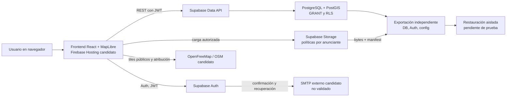
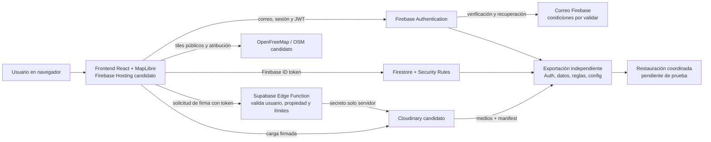
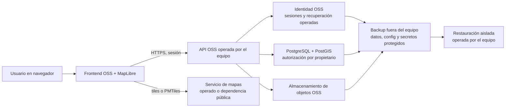

# Propuesta de hito F01-H00: Evaluación y selección de arquitectura base del MVP

**Estado:** F01-H00 abierto por dirección el 2026-10-16. Evaluación técnica documental/local autorizada; creación de cuentas/recursos requiere la puerta de autorización externa del [protocolo técnico](protocolo-pruebas-tecnicas.md). No autoriza selección o implementación.
**Nombre solicitado:** “F01-H00: Evaluación y selección de arquitectura base del MVP”.
**Nomenclatura:** F01-H00 fue ratificado y abierto por dirección junto al cierre de F00-H04 el 2026-10-16.

## Propósito

Elegir, mediante criterios y pruebas acotadas aprobadas por dirección, una arquitectura base adecuada al MVP ratificado, con prioridad por software abierto, portabilidad y menor gasto sostenible. La evaluación no presupone que los servicios gratuitos sean aptos ni que pagar sea obligatorio. Debe comprobar requisitos, recuperación, operación y términos antes de recomendar o seleccionar.

## Entradas

- [Alcance MVP ratificado](../../F00/H04/propuesta-alcance-mvp.md).
- [Viabilidad económica y escenarios](../../F00/H04/viabilidad-costo-cero.md).
- [Auditoría y recomendación de cierre H04](../../F00/H04/cierre-propuesto.md).
- [Visión y alcance del producto](../../../direccion/vision-y-alcance.md).
- Decisiones humanas pendientes de topes del piloto, contabilidad de costos de operación, volumen, privacidad, recuperación y equipo disponible. La política USD 0 por defecto ya está aprobada en [decisiones del proyecto](../../../direccion/decisiones.md).

## Candidatas de evaluación

Estas son configuraciones evaluables, no elecciones. Servicios, licencias, cuotas y elegibilidad comercial deben volver a validarse al iniciar el hito.

| Capa | A. Núcleo gestionado integrado | B. Servicios gratuitos desacoplados |
| --- | --- | --- |
| Frontend/despliegue | React + MapLibre, artefacto estático en Firebase Hosting Spark | React + MapLibre, Firebase Hosting Spark |
| Backend | API y funciones Supabase | Firestore SDK/reglas para datos; Supabase Edge Function solo para firmar subida de foto |
| Geodatos | Supabase PostgreSQL/PostGIS y consulta por geometría/distancia | Firestore, campo sector Tunja y geohash/GeoPoint con búsqueda por celdas y filtrado exacto en cliente o función; validar falsos positivos/lecturas |
| Auth | Supabase Auth, correo/contraseña | Firebase Authentication, correo/contraseña |
| Correo | Brevo Free por SMTP personalizado Supabase, luego de confirmar términos, dominio y aprobación de cuenta | Correos nativos Firebase Auth para verificación y recuperación |
| Fotos | Supabase Storage, políticas por anunciante | Cloudinary Free; endpoint de firma en Supabase Edge Function valida Firebase ID token, dueño de publicación, contenido y límites; el secreto queda servidor |
| Mapa/tiles | MapLibre + OpenFreeMap/OSM, atribución y fallback lista | MapLibre + OpenFreeMap/OSM, atribución y fallback lista |
| Copias | Export DB/Auth/Storage/config por componentes; archivos aparte en B2 y copia cifrada local | Export Auth, Firestore, reglas/índices y fotos/manifest por separado a B2 y copia cifrada local |
| Restauración | Restaurar DB/Auth/objetos en entorno limpio, validar IDs, policies y hashes | Importar usuarios/documentos y reconstruir reglas/índices, cargar medios, validar referencias y permisos |

Los nombres de productos hacen la propuesta comprobable, pero continúan siendo candidatos. Si los términos, prueba comercial, controles de costo o restauración fallan, el resultado puede ser descartar una candidata y modelar sustitución, no avanzar con excepción.

### A. Plataforma gestionada con software abierto cuando sea posible

- **Frontend:** React OSS y renderer MapLibre OSS, artefacto estático en Firebase Hosting Spark candidato.
- **Backend/API:** Supabase como backend gestionado integrado; PostgreSQL/PostGIS OSS para modelo inmueble/unidad y consultas espaciales; API/policies/RLS y funciones servidor candidatas.
- **Autenticación/correo:** Supabase Auth con correo/contraseña; Brevo Free como SMTP candidato para verify/reset, únicamente tras verificar dominio, condiciones y cuota. SMTP default Supabase excluido.
- **Fotografías:** Supabase Storage con cinco imágenes optimizadas por anuncio bajo tamaño/dimensiones objetivo; upload autorizado y límites ejecutados servidor.
- **Mapa:** MapLibre con OpenFreeMap/OSM candidato, selección de sector/pin, atribución y fallback de resultados en lista.
- **Copias:** exportaciones separadas de Postgres, Auth, Storage metadata/config y bytes de objetos a Backblaze B2 candidato (10 GB publicado) más copia cifrada local independiente.
- **Restauración:** recrear schema/policies/config, cargar usuarios, filas y objetos en entorno limpio; verificar conteos, hashes, IDs, relaciones y pruebas de tenant.
- **Despliegue:** hosting y Supabase en planes gratuitos sin billing solo si cuenta y condiciones lo permiten; ningún dominio, servicio o cuenta se activa durante la propuesta.

**Hipótesis a contrastar:** relaciones/PostGIS y control integrado pueden reducir complejidad de dominio. Riesgos a medir: egress/storage gratis, SMTP y backup separados, exportación Auth/Storage, pausa y lock-in de backend.

### B. Arquitectura modular con servicios gratuitos desacoplados

- **Frontend/despliegue:** React OSS + MapLibre OSS en Firebase Hosting Spark candidato.
- **Backend/API:** Firestore SDK y rules para datos; Supabase Edge Function Free solo para firmar cargas Cloudinary. La función valida token Firebase, propietario, formato/bytes y rate limits; el secreto de firma nunca se expone.
- **Datos geográficos:** Firestore con sector explícito, GeoPoint/geohash; intersectar celdas para candidatos y filtrar distancia con coordenadas normalizadas. Comparar legibilidad, número de lecturas, límites y precisión contra A/PostGIS.
- **Autenticación/correo:** Firebase Authentication con confirmación/recuperación nativas y cuotas publicadas.
- **Fotografías:** Cloudinary Free con optimización/transformación; subir solo versión objetivo y mantener un manifest exportable. Endpoint firmado impone tope de cinco fotos y tamaño/dimensiones aprobados.
- **Mapa:** MapLibre con OpenFreeMap/OSM candidato, atribución y degradación a sectores/lista si tile o mapa falla.
- **Copias/restauración:** export Auth, Firestore, rules/índices, configuración y fotos a Backblaze B2 candidato más copia cifrada local; reimportar por componentes en entorno limpio, verificar IDs, referencias, hashes y reglas.
- **Despliegue:** hosting Firebase Spark y firmador Supabase Edge Free, sin activar Firebase Cloud Functions (requiere Blaze) ni facturación; solo aceptar si la cuenta permite uso sin método de pago y términos lo permiten.

**Hipótesis a contrastar:** cuotas especializadas y límites explícitos podrían favorecer un piloto reducido. Riesgos a medir: más credenciales, dependencias, puntos de falla, consistencia distribuida, más acuerdos de tratamiento y migraciones complejas.

### Alternativa comparativa: autohospedaje

Mantener como referencia, no como candidato preferido por su licencia: componentes OSS para frontend, API, PostgreSQL/PostGIS, identidad y almacenamiento de objetos, operados en equipo propio o infraestructura contratada. Contabilizar energía/conectividad, dominio, backup fuera del sitio, seguridad, parches, observabilidad, alta disponibilidad y horas operativas. “Servidor existente” no equivale a costo económico cero. Comparar solo si dirección confirma responsable operativo y recursos.

### Flujos de arquitectura para comparación

Los diagramas representan límites y transferencias de datos de las candidatas, no una elección ni una autorización para crear los recursos.

#### A. Plataforma gestionada integrada

#### B. Servicios gratuitos desacoplados

#### C. Autohospedaje de referencia

La comparación de recuperación debe contar también identidades, configuración, policies/rules, índices, claves operativas y medios. En A y B los servicios de respaldo sugeridos siguen siendo candidatos no activados; en C la disponibilidad, red y custodia operativa recaen en el equipo.

## Política económica de evaluación

La política económica aprobada por dirección establece:

- Desarrollo: objetivo USD 0.
- Piloto: buscar USD 0 con controles de seguridad y recuperación.
- Producción: priorizar gratuidad mientras sea sostenible.
- Ningún gasto sin autorización humana expresa.
- No sacrificar seguridad ni recuperación para mantener artificialmente costo cero.

F01-H00 debe comparar costo monetario mensual, costos extraordinarios, dominio, dependencia, cuotas, tiempo de operación y costo de recuperación. La contabilidad exacta de infraestructura mensual, dominios, correo, equipo existente, energía, horas de trabajo, impuestos, soporte y copias debe presentarse con claridad, sin alterar la política aprobada.

## Puertas de aprobación

1. **Entrada:** denominación, apertura formal y MVP de referencia están ratificados. Dirección aún debe decidir alcance/límites del piloto, objetivos de recuperación, contabilidad y responsables. La política económica USD 0 por defecto ya está ratificada.
2. **Diseño:** dirección aprueba criterios ponderados, requisito de datos/privacidad, arquitectura de seguridad, RPO/RTO objetivo, volumen de prueba y servicios/cuentas que se permite crear.
3. **Pruebas externas:** autorización específica para crear cuentas o activar servicios. Sin ella, hacer únicamente análisis documental/local y marcar resultados de cuenta como no verificados.
4. **Selección:** presentar resultados y tradeoffs; dirección aprueba arquitectura, proveedores, stack, costos y responsables en un registro de decisión explícito.
5. **Implementación:** requiere cierre de F01-H00, aprobación de arquitectura y apertura/autorización de hito de implementación separado. Este documento no la autoriza.

## Criterios de evaluación propuestos

Puntuación 0 a 5 con evidencia, sin sesgo por modularidad. Seguridad, legalidad/uso comercial, recuperación, ajuste al MVP y ausencia de gasto no autorizado son puertas obligatorias, no compensables con puntuación alta en costo o velocidad.

| Criterio | Peso inicial propuesto | Evidencia de aceptación |
| --- | ---: | --- |
| Ajuste funcional a inmueble/unidad, publicaciones y búsqueda | 15% | Consultas de mapa/lista/detalle y reglas de dominio con datos sintéticos |
| Seguridad de autenticación y aislamiento de anunciantes | Puerta + 15% | Pruebas negativas cruzadas, reset/verify y review de políticas |
| Recuperación/portabilidad | Puerta + 15% | Restore drill completo, checksum, integridad de usuarios/medios y RPO/RTO comparados contra objetivos humanos |
| Viabilidad económica y límite de gasto | Puerta + 15% | Tabla de cuotas y prueba/inspección de controles sin gasto automático; costos explícitos |
| Permiso comercial y obligaciones | Puerta + 10% | Términos oficiales vigentes por producto y cuenta, remitente y revisión requerida identificados |
| Ajuste geográfico para Tunja | 10% | Casos representativos de sectores, distancia/falsos resultados y fallback validados |
| Carga operativa y resiliencia | 10% | Runbook, responsable, respuesta a pausa/indisponibilidad y tareas periódicas estimadas |
| Software abierto y salida | 10% | Inventario de licencias, formato de exportación, plan de migración y datos servibles sin proveedor |

Los pesos son propuesta; su ajuste y umbrales de desempate requieren aprobación. La suma de factores ponderados no puede compensar el incumplimiento de una puerta obligatoria.

## Escenarios y control del piloto

Conservar comparaciones de 200, 1.000 y 5.000 anuncios como escenarios, no capacidades universales. Añadir piloto controlado propuesto de máximo 200 publicaciones activas, cinco imágenes por publicación, objetivo de hasta 250 KB por imagen optimizada, 0,25 GB de imágenes almacenadas, y 2,5 GB/mes de transferencia de fotos según diez visitas de detalle por anuncio. Estos umbrales son una base aritmética a revisar, no límites de producto ni de seguridad aprobados.

Medir uso real por servicio, con alerta operativa sugerida al 70%, revisión al 85% y corte de nuevas altas/cargas antes de 95% si no hay headroom confirmado. Ningún presupuesto/alerta equivale a límite duro. Para mantener $0 no habilitar billing ni autosobrecarga. Si un proveedor obliga a registrar pago, suspende por cuota o no tiene restauración adecuada, retirar esa candidata o presentar a dirección el costo mínimo y el riesgo antes de seguir.

## Criterios de aceptación propuestos

- **AC-01 Evidencia:** cada afirmación sobre cuota, licencia, disponibilidad, uso comercial o costo tiene fuente y fecha; se separa contrato público de estado de cuenta.
- **AC-02 Arquitecturas:** A, B y referencia autohospedada cubren todas las capas; diagramas y flujos de datos permiten comparar dependencia y recuperación.
- **AC-03 Seguridad/auth:** evaluar autenticación y autorización aplicables al MVP y demostrar que no existe acceso horizontal no autorizado. Por decisión de dirección del 2026-10-16, el envío real de correos de confirmación y recuperación queda fuera de F01-H00 y se traslada a una validación previa a usuarios reales. F01-H00 no declarará esos flujos probados; conservará su estado pendiente para esa etapa.
- **AC-04 Backup/restore:** backup independiente incluye datos, usuarios, roles, config y fotos; restauración aislada valida checksums, vínculos y permisos, con RPO/RTO medidos frente a metas aprobadas.
- **AC-05 Fotos:** subida limitada por bytes, dimensiones, formato y cantidad; se prueba contenido inválido, metadatos EXIF, miniatura, carga diferida, derechos y eliminación.
- **AC-06 Mapa Tunja:** búsqueda por sectores/localización de prueba coincide con casos aprobados por dirección y presenta lista utilizable cuando el mapa/tile/geocoder falla.
- **AC-07 Resiliencia:** simulación acotada de storage, mapa, backend o cuota indisponible no filtra datos ni crea publicaciones corruptas; mensaje/fallback documentado. Por decisión de dirección, no ejecutar en F01-H00 pruebas de entrega ni indisponibilidad de correo; documentar sus límites y validarlas antes de usuarios reales.
- **AC-08 Economía:** 200/1.000/5.000 y piloto controlado tienen supuestos, cuotas, first limit, error/bloqueo y costos modelados; no se autoriza gasto accidental.
- **AC-09 Condiciones:** uso comercial, privacidad, límites, región y términos de cada servicio candidato pasan revisión aplicable; lo que no pueda certificarse queda como bloqueo.
- **AC-10 Decisión:** recomendación trazable y decisión de dirección aceptada o alternativas rechazadas con motivo; no se implementa en este hito.

## Plan SDD propuesto

1. **Spec:** ratificar objetivos, restricciones, escenario controlado, puertas, objetivos RPO/RTO, criterios y preguntas legales/operativas.
2. **Plan:** seleccionar solo la matriz de pruebas y datos sintéticos; autorización específica para las cuentas/servicios que requieran activación.
3. **Tasks:** planear consultas Tunja, escenarios de quota, auth/tenant tests, medios, export/restore, contingencia y evaluación de términos.
4. **Implementación de pruebas:** si autorizada, preparar fixtures, scripts/procedimientos desechables y configuración mínima de prueba. No construir funcionalidad MVP salvo apertura aprobada de un hito distinto.
5. **Pruebas:** ejecutar primero localmente; pruebas con cuentas únicamente luego de autorización y sin facturación no aprobada.
6. **Análisis:** contrastar A/B/autohospedaje con datos observados, incidentes y cuotas.
7. **Documentación:** resultados, decisiones, operación, procedimientos de salida y brechas.
8. **Cierre:** revisión y aceptación humana de arquitectura base; F01-H00 no despliega ni implementa producto.

## Entradas y decisiones humanas pendientes

- ¿Se acepta el piloto de referencia de hasta 200 anuncios y los límites propuestos de foto/egreso?
- ¿Qué alcance contable se reportará para infraestructura y operación, incluyendo equipo existente, energía y horas humanas?
- ¿Qué RPO/RTO, recuperación y disponibilidad se exigen para piloto y producción?
- Está pendiente la autorización condicionada para crear una nueva organización y un proyecto Supabase Free aislados, descrita con límites y plan de eliminación en el [protocolo técnico](protocolo-pruebas-tecnicas.md).
- ¿Quién opera moderación, backups, recuperación, límites y respuesta a indisponibilidad?
- ¿Qué tratamiento de ubicación/contactos y obligaciones jurídicas deben resolverse antes del piloto?

## Estado del siguiente paso

F01-H00 fue abierto por dirección el 2026-10-16. La evaluación documental/local inicial está en [evaluacion.md](evaluacion.md). No crear cuentas, activar servicios, desarrollar la aplicación o realizar pruebas contra cuentas ni iniciar despliegue sin la autorización específica correspondiente. La selección arquitectónica requiere decisión humana explícita.
